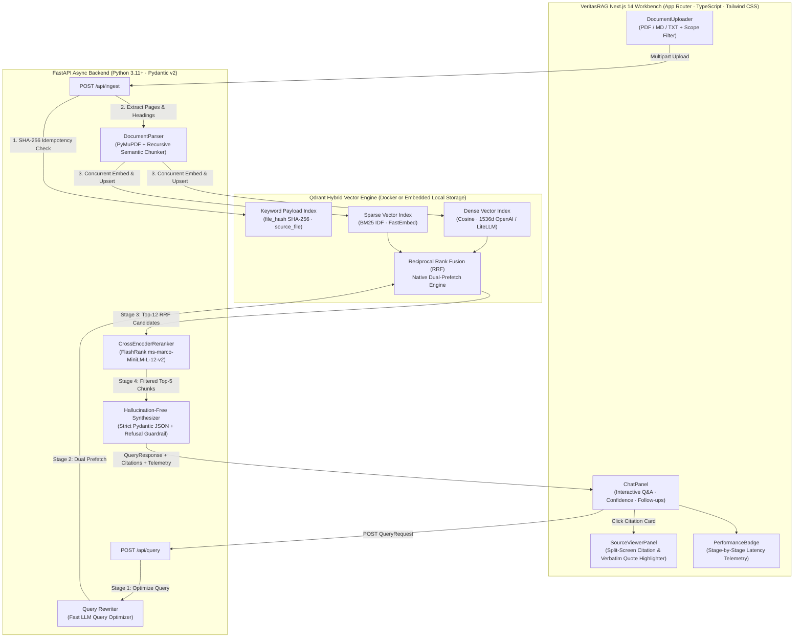

<div align="center">

# 🛡️ VeritasRAG

### Production-Grade Hybrid RAG & Citation Verification Engine
*Dense Semantic Vectors + Sparse BM25 · Reciprocal Rank Fusion (RRF) · Cross-Encoder Reranking · Hallucination-Free Verbatim Citations*

[](https://www.python.org/)
[](https://fastapi.tiangolo.com/)
[](https://docs.pydantic.dev/)
[](https://qdrant.tech/)
[-000000?style=for-the-badge&logo=next.js&logoColor=white)](https://nextjs.org/)
[](https://www.typescriptlang.org/)
[](https://www.docker.com/)
[](https://docs.pytest.org/)

</div>

---

## 📖 Table of Contents
- [Overview & Problem Statement](#-overview--problem-statement)
- [System Architecture & Diagrams](#-system-architecture--diagrams)
- [Core Engineering Capabilities](#-core-engineering-capabilities)
- [Tech Stack](#-tech-stack)
- [Repository Structure](#-repository-structure)
- [Getting Started & Execution Modes](#-getting-started--execution-modes)
  - [Mode 1: Docker Compose (Full-Stack Containerized)](#mode-1-docker-compose-full-stack-containerized)
  - [Mode 2: Local Host Execution Without Docker (Embedded Qdrant)](#mode-2-local-host-execution-without-docker-embedded-qdrant)
  - [Mode 3: Zero-API-Key Deterministic Offline Mode](#mode-3-zero-api-key-deterministic-offline-mode)
- [REST API Reference](#-rest-api-reference)
- [Environment Configuration (`.env`)](#-environment-configuration-env)
- [Automated Test Suite (`pytest`)](#-automated-test-suite-pytest)
- [AI-Assisted Engineering Workflow](#-ai-assisted-engineering-workflow)

---

## 🎯 Overview & Problem Statement

**VeritasRAG** is a full-stack Document Intelligence System engineered to eliminate the three primary failure modes of naive vector-only Retrieval-Augmented Generation:

1. **Lexical Blindness in Dense Embeddings:** Standard dense bi-encoders compress passages into a single vector, frequently missing exact product SKUs, error codes (`ERR_4092`), statutory clauses, function signatures, or domain acronyms.
2. **Bi-Encoder Precision Degradation:** Independent cosine similarity scoring lacks token-level interaction between the query and candidate passages, allowing noisy chunks to pollute the LLM context window.
3. **Unverified Hallucinations:** Without strict output schemas and pre-generation relevance circuit breakers, LLMs blend parametric memory with retrieved context and fabricate citations.

### How VeritasRAG Solves This

| Pipeline Stage | Module | Engineering Mechanism |
| :--- | :--- | :--- |
| **1. Idempotent Ingestion** | `DocumentParser` + `SHA-256` Guard | Recursive semantic chunking (`800` chars, `150` overlap) preserving `source_file`, `page_number`, and `section_title` with $O(1)$ duplicate detection. |
| **2. Query Rewriting** | `LLMService.rewrite_query` | Expands ambiguous user questions into self-contained semantic queries while preserving exact identifiers for BM25 lexical matching. |
| **3. Hybrid RRF Retrieval** | `QdrantHybridService` (`Dense` + `BM25`) | Executes concurrent Dense Cosine (`1536d`) and Sparse BM25 (`IDF`) prefetches fused server-side via **Reciprocal Rank Fusion (RRF)**. |
| **4. Cross-Encoder Rerank** | `CrossEncoderReranker` (`FlashRank`) | Jointly scores `(query, chunk)` pairs using `ms-marco-MiniLM-L-12-v2` on CPU and filters out candidates below `0.20` relevance. |
| **5. Grounded Synthesis** | `LLMStructuredOutput` (Pydantic v2) | Enforces strict JSON output containing verbatim quotes, page numbers, calibrated confidence, follow-up queries, and a deterministic **Refusal Guardrail**. |

---

## 🏗 System Architecture & Diagrams

### Mermaid Architecture Diagram



### ASCII Pipeline Flow

```text
+-----------------------------------------------------------------------------------+
|                        1. INGESTION PIPELINE (/api/ingest)                        |
+-----------------------------------------------------------------------------------+
  [PDF / MD / TXT]
         |
         v
  [SHA-256 File Hash] ---> (Qdrant Payload Index Check) ---> [Exists?] --YES--> [201 duplicate_skipped]
         |                                                       |
         | NO                                                    v
         +---> [PyMuPDF / Markdown Section Extractor]
         |
         +---> [Recursive Semantic Chunker (800 chars, 150 overlap)]
         |       Metadata: source_file, file_hash, page_number, section_title, chunk_index
         |
         +---> [asyncio.gather]
                 |-- Dense Embeddings (OpenAI text-embedding-3-small, 1536d)
                 +-- Sparse Embeddings (FastEmbed Qdrant/bm25, IDF modifier)
                         |
                         v
               [Qdrant Batch Upsert (Deterministic UUID5 Point IDs)]

+-----------------------------------------------------------------------------------+
|                     2. HYBRID QUERY PIPELINE (/api/query)                         |
+-----------------------------------------------------------------------------------+
  [User Question]
         |
         v
  [Stage 1: LLM Query Rewriter]          (Expands acronyms & preserves exact keywords)
         |
         v
  [Stage 2: Qdrant Hybrid Prefetch + RRF]
         |-- Prefetch #1: Dense Cosine Similarity (Top 20)
         +-- Prefetch #2: Sparse BM25 Keyword Match (Top 20)
                 |
                 v
         [Reciprocal Rank Fusion (RRF) -> Top 12 Candidates]
                 |
                 v
  [Stage 3: FlashRank Cross-Encoder]     (ms-marco-MiniLM-L-12-v2 joint scoring >= 0.20)
         |
         |-- [0 Chunks Pass Threshold?] ---> [Deterministic Refusal Guardrail (No Hallucination)]
         |
         v (Top 5 Chunks)
  [Stage 4: Structured LLM Synthesis]    (Enforced Pydantic Schema: LLMStructuredOutput)
         |
         v
  [JSON Response: Markdown Answer + Verbatim Citations + Confidence + Latency Breakdown]
```

---

## ✨ Core Engineering Capabilities

### 1. Reciprocal Rank Fusion (RRF) Hybrid Search
Rather than relying on arbitrary linear score weights between incompatible vector spaces (Cosine $\in [-1, 1]$ vs. unbounded BM25 scores), **VeritasRAG** fuses candidate rankings server-side in Qdrant using Reciprocal Rank Fusion:

$$\text{RRF\_Score}(d \in D) = \sum_{m \in \{\text{dense}, \text{sparse}\}} \frac{1}{k + r_m(d)}$$

where $r_m(d)$ is the rank of document chunk $d$ under retrieval modality $m$ and $k$ is the ranking constant. Passages that rank highly in **both** semantic meaning and exact keyword overlap are promoted to the top of the candidate pool.

### 2. Two-Layer Idempotent Ingestion
- **Layer 1 (Pre-Parse Hash Check):** Raw file bytes are hashed with `SHA-256` and checked against Qdrant's indexed `file_hash` keyword field before any PDF parsing or embedding API calls take place.
- **Layer 2 (Deterministic Point UUIDs):** Every chunk ID is generated via `uuid.uuid5(NAMESPACE, f"{file_hash}:{chunk_index}")`, guaranteeing zero duplicate vectors even under concurrent ingestion retries.

### 3. Split-Screen Citation Verification Workbench
- **Left Pane (`ChatPanel`):** Renders the optimized search query, confidence percentage badge, refusal alert banner, markdown answer, interactive citation cards, and stage-by-stage latency telemetry (`PerformanceBadge`).
- **Right Pane (`SourceViewerPanel`):** Selecting any citation card opens the corresponding document chunk, displays its `page_number`, `section_title`, `RRF Score`, and `FlashRank Score`, and **highlights the exact verbatim quote** (`<mark>`) inside the source passage.

---

## 🛠 Tech Stack

- **Backend:** Python 3.11+, FastAPI, Pydantic v2, `pydantic-settings`, AsyncIO, Uvicorn
- **AI & Retrieval:** LiteLLM / OpenAI SDK, Qdrant (`qdrant-client` Async), FastEmbed (`Qdrant/bm25`), FlashRank (`ms-marco-MiniLM-L-12-v2` ONNX Cross-Encoder)
- **Document Parsing:** PyMuPDF (`fitz`), custom hierarchical recursive semantic splitter
- **Frontend:** Next.js 14 (App Router), React 18, TypeScript 5, Tailwind CSS, Lucide Icons
- **Infrastructure & Testing:** Docker, Docker Compose, Pytest, `pytest-asyncio`

---

## 📂 Repository Structure

```text
veritas-rag/
├── docker-compose.yml                 # Orchestrates Qdrant, FastAPI Backend, and Next.js Frontend
├── .env.example                       # Environment configuration template
├── .gitignore                         # Git ignore rules for Python, Node, and local Qdrant storage
├── README.md                          # Project documentation
│
├── backend/
│   ├── Dockerfile                     # Python 3.11-slim container definition
│   ├── requirements.txt               # Pinned backend dependencies
│   ├── pytest.ini                     # Pytest async configuration
│   ├── app/
│   │   ├── main.py                    # FastAPI app entrypoint, CORS, lifespan initialization
│   │   ├── config.py                  # Pydantic v2 BaseSettings configuration
│   │   ├── models/
│   │   │   └── schemas.py             # Strict Pydantic v2 contracts (Citations, RAGResponse, Latency)
│   │   ├── services/
│   │   │   ├── parser.py              # PyMuPDF + Markdown/TXT recursive semantic chunker
│   │   │   ├── qdrant_service.py      # Async Qdrant client, SHA-256 idempotency, Dense+BM25 RRF
│   │   │   ├── reranker.py            # Local FlashRank Cross-Encoder reranking service
│   │   │   └── llm_service.py         # Query Rewriter + Hallucination-free JSON synthesizer
│   │   └── api/
│   │       └── routes.py              # /api/ingest, /api/query, /api/documents, /api/health
│   └── tests/
│       ├── conftest.py                # Pytest fixtures & async Qdrant mocks
│       ├── test_parser.py             # Chunking, overlap, PDF page & section extraction tests
│       ├── test_qdrant.py             # Idempotency, hybrid upsert & RRF query tests
│       └── test_query_pipeline.py     # Structured citation parsing & refusal guardrail tests
│
└── frontend/
    ├── Dockerfile                     # Node 20 Alpine container definition
    ├── package.json
    ├── tsconfig.json
    ├── tailwind.config.ts
    └── src/
        ├── app/
        │   ├── layout.tsx             # Dark-mode root layout
        │   ├── page.tsx               # Split-screen workbench controller
        │   └── globals.css            # Tailwind & custom scrollbar styles
        ├── components/
        │   ├── DocumentUploader.tsx   # Multipart upload & document scope filter bar
        │   ├── ChatPanel.tsx          # Interactive Q&A stream & follow-up pills
        │   ├── CitationCard.tsx       # Clickable source citation cards
        │   ├── PerformanceBadge.tsx   # Stage-by-stage latency telemetry badge
        │   └── SourceViewerPanel.tsx  # Right-pane context viewer with verbatim quote highlighting
        └── lib/
            ├── api.ts                 # Typed REST client
            └── types.ts               # TypeScript interfaces matching Pydantic schemas
```

---

## 🚀 Getting Started & Execution Modes

**VeritasRAG** supports three execution modes depending on your environment: **Docker Compose**, **Local Host Execution without Docker** (using embedded Qdrant storage), and **Zero-API-Key Offline Mode**.

---

### Mode 1: Docker Compose (Full-Stack Containerized)

> **Prerequisite:** Ensure **Docker Desktop** (or the Docker daemon) is running.

```bash
# 1. Clone the repository
git clone https://github.com/your-username/veritas-rag.git
cd veritas-rag

# 2. Create your .env file and configure OPENAI_API_KEY
cp .env.example .env

# 3. Build and start Qdrant + Backend + Frontend
docker compose up --build
```

Access the running services:
- **VeritasRAG Next.js Workbench:** [http://localhost:3000](http://localhost:3000)
- **FastAPI Interactive OpenAPI Docs:** [http://localhost:8000/docs](http://localhost:8000/docs)
- **Qdrant Vector Dashboard:** [http://localhost:6333/dashboard](http://localhost:6333/dashboard)

---

### Mode 2: Local Host Execution Without Docker (Embedded Qdrant)

If Docker is not installed or running, the backend automatically defaults to **embedded local Qdrant storage** (`./qdrant_local_storage`), requiring zero external database containers.

#### Step 1: Start the FastAPI Backend (Terminal 1)

**Windows (`cmd.exe` / PowerShell):**
```cmd
cd backend
pip install -r requirements.txt
python -m uvicorn app.main:app --host 0.0.0.0 --port 8000 --reload
```

**macOS / Linux:**
```bash
cd backend
python3 -m venv .venv && source .venv/bin/activate
pip install -r requirements.txt
python -m uvicorn app.main:app --host 0.0.0.0 --port 8000 --reload
```

#### Step 2: Start the Next.js Frontend (Terminal 2)

```bash
cd frontend
npm install
npm run dev
```

Navigate to **[http://localhost:3000](http://localhost:3000)** in your browser.

---

### Mode 3: Zero-API-Key Deterministic Offline Mode

To evaluate document chunking, SHA-256 deduplication, BM25 sparse vector indexing, Qdrant RRF fusion, FlashRank Cross-Encoder reranking, and UI quote highlighting **without an external LLM API key**:
- Keep the default placeholder `OPENAI_API_KEY=sk-your-openai-api-key-here` in `.env`.
- The backend automatically activates its **deterministic local dense embedding & extractive synthesis fallback**, enabling complete end-to-end testing offline.
- Supplying a live `OPENAI_API_KEY` in `.env` seamlessly switches the pipeline to live `text-embedding-3-small` embeddings and `gpt-4o-mini` structured generation.

---

## 📡 REST API Reference

### 1. `POST /api/ingest` — Ingest Document (PDF, MD, TXT)

```bash
curl -X POST "http://localhost:8000/api/ingest" \
  -F "file=@architecture_spec.pdf"
```

**Response (`201 Created`):**
```json
{
  "status": "ingested",
  "source_file": "architecture_spec.pdf",
  "file_hash": "9f86d081884c7d659a2feaa0c55ad015a3bf4f1b2b0b822cd15d6c15b0f00a08",
  "total_pages": 12,
  "chunks_indexed": 34,
  "processing_time_ms": 412.65,
  "message": "Successfully parsed and indexed 34 hybrid chunks from 'architecture_spec.pdf'."
}
```
*(Uploading an identical file a second time returns `"status": "duplicate_skipped"` in `< 5ms` via Qdrant payload index lookup.)*

---

### 2. `POST /api/query` — Hybrid RRF Search + Rerank + Cited Synthesis

```bash
curl -X POST "http://localhost:8000/api/query" \
  -H "Content-Type: application/json" \
  -d '{
    "query": "How are dense and sparse vectors combined during retrieval?",
    "source_filter": null
  }'
```

**Response (`200 OK`):**
```json
{
  "original_query": "How are dense and sparse vectors combined during retrieval?",
  "rewritten_query": "Qdrant hybrid search dense cosine similarity sparse BM25 Reciprocal Rank Fusion RRF",
  "answer": "During retrieval, the engine executes dual prefetch queries against **Dense Cosine** and **Sparse BM25** indexes and merges them using **Reciprocal Rank Fusion (RRF)** `[architecture_spec.pdf, p. 4]`.",
  "citations": [
    {
      "source_file": "architecture_spec.pdf",
      "page_number": 4,
      "section_title": "2.1 Hybrid Retrieval Engine",
      "chunk_index": 7,
      "exact_quote": "Qdrant executes Reciprocal Rank Fusion (RRF) over dense cosine and sparse BM25 prefetch lists.",
      "relevance_score": 0.9412
    }
  ],
  "confidence_score": 0.95,
  "follow_up_questions": [
    "How does the FlashRank Cross-Encoder filter the RRF candidates?",
    "What happens when no chunk meets the relevance score threshold?"
  ],
  "refused": false,
  "latency": {
    "query_rewrite_ms": 184.2,
    "embedding_ms": 92.4,
    "qdrant_search_ms": 11.8,
    "rerank_ms": 28.5,
    "llm_generation_ms": 640.1,
    "total_ms": 957.0
  },
  "retrieved_chunks": [...]
}
```

---

## ⚙️ Environment Configuration (`.env`)

| Variable | Default | Description |
| :--- | :--- | :--- |
| `OPENAI_API_KEY` | `sk-your-...` | OpenAI API key for dense embeddings & LLM synthesis |
| `LLM_MODEL` | `gpt-4o-mini` | Primary LiteLLM model for structured JSON generation |
| `QUERY_REWRITER_MODEL` | `gpt-4o-mini` | Fast LLM used for query optimization |
| `EMBEDDING_MODEL` | `text-embedding-3-small` | Dense embedding model (`1536` dimensions) |
| `QDRANT_HOST` | `localhost` | Qdrant hostname (`qdrant` inside Docker Compose) |
| `QDRANT_PORT` | `6333` | Qdrant REST/HTTP port |
| `QDRANT_LOCAL_PATH` | `./qdrant_local_storage` | Local disk path for Docker-free embedded Qdrant mode |
| `SPARSE_MODEL_NAME` | `Qdrant/bm25` | FastEmbed sparse lexical model |
| `RERANKER_MODEL_NAME` | `ms-marco-MiniLM-L-12-v2` | FlashRank ONNX Cross-Encoder model |
| `CHUNK_SIZE` | `800` | Maximum character length per semantic chunk |
| `CHUNK_OVERLAP` | `150` | Sliding-window character overlap between adjacent chunks |
| `HYBRID_PREFETCH_LIMIT` | `20` | Candidates prefetched per vector modality before RRF |
| `RRF_TOP_K` | `12` | Fused RRF candidates passed to FlashRank |
| `RERANK_TOP_K` | `5` | Top reranked chunks passed into the LLM prompt |
| `RERANK_SCORE_THRESHOLD` | `0.20` | Minimum cross-encoder score required to avoid refusal |

---

## 🧪 Automated Test Suite (`pytest`)

The backend ships with an async unit test suite verifying recursive chunking, PDF page metadata extraction, Qdrant dual-vector provisioning, SHA-256 idempotency, RRF fusion queries, mocked LLM structured citation validation, and the refusal guardrail:

```bash
cd backend
pytest -v
```

---

## 🤖 AI-Assisted Engineering Workflow

**VeritasRAG** was designed and implemented through a disciplined **Human-in-the-Loop AI-Assisted Engineering Workflow**. Rather than treating AI code generation as an unverified black box, development was structured across five gated architectural phases with targeted manual systems optimizations:

1. **Schema-First Contract Design:**
   - Strictly typed Pydantic v2 models (`ConfigDict(extra="forbid")`) and matching TypeScript interfaces were defined upfront as the single source of truth between FastAPI and Next.js.
2. **Non-Blocking Async Event-Loop Execution (`asyncio.to_thread` & `asyncio.gather`):**
   - Naive AI-generated RAG pipelines often invoke CPU-bound local models (`FastEmbed` BM25 and `FlashRank` ONNX cross-encoder inference) synchronously inside `async def` endpoints, stalling the FastAPI event loop under concurrent requests. Both operations were isolated inside `asyncio.to_thread(...)`, while Dense and Sparse embeddings are computed concurrently via `asyncio.gather(...)`.
3. **Server-Side Qdrant `Prefetch` + `Fusion.RRF`:**
   - Replaced fragile client-side score normalization with Qdrant's native `query_points` API utilizing dual `Prefetch` clauses and `FusionQuery(fusion=Fusion.RRF)` in a single network round-trip.
4. **Deterministic Pre-LLM Refusal & Score Calibration:**
   - LLMs frequently misreport their own citation relevance scores or hallucinate when provided weak context. We implemented a hard pre-LLM circuit breaker when zero chunks survive `RERANK_SCORE_THRESHOLD` (`0.20`), and programmatically overwrite citation `relevance_score` fields with the calibrated cross-encoder score from `FlashRank`.

---

<div align="center">
  <sub>Engineered for a Senior AI & Backend Systems Portfolio · <b>VeritasRAG</b></sub>
</div>
